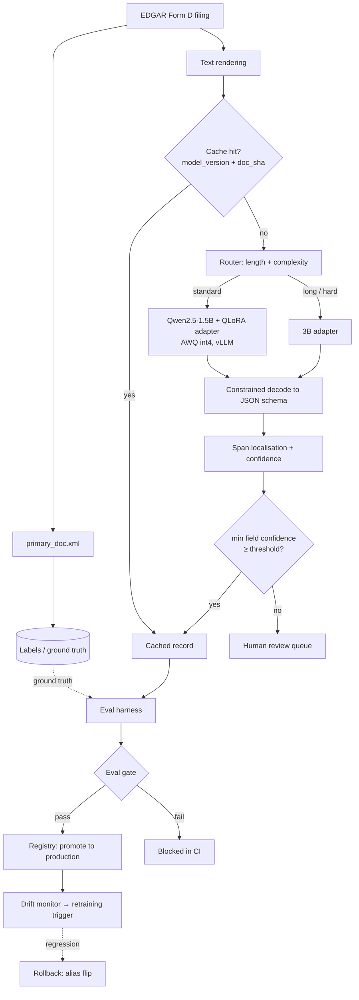

# FundLens

**A governed lifecycle for a small open-weight language model — from benchmarking to retirement — on private-markets filings.**

FundLens extracts 14 structured fields from US SEC **Form D** private-fund offering filings and
returns them with character-level provenance and per-field confidence. The extraction is the
vehicle; the subject of the project is the **lifecycle around the model**: discovery,
benchmarking, governed dataset construction, parameter-efficient fine-tuning, evaluation gates,
registry and controlled promotion, routing, caching, drift monitoring, rollback and retirement.

[](LICENSE)
[](https://www.python.org/)
[](#evaluation-gate)

---

## The claim this repo is built to test

> For a narrow, schema-bound, high-volume extraction task, a **1.5B open-weight model fine-tuned
> with QLoRA outperforms a frontier model prompted zero-shot** — at a fraction of the cost per
> document. The difficult part is not the fine-tune. It is everything that has to be true before
> you are allowed to deploy it.

The repo is organised so that claim can be **falsified**. Four baselines run before the fine-tune.
If the cheapest one clears the bar, the honest conclusion is *don't fine-tune* — and that result
would be reported here just as prominently.

---

## Table of contents

- [Why Form D](#why-form-d)
- [What gets extracted](#what-gets-extracted)
- [Architecture](#architecture)
- [The baseline ladder](#the-baseline-ladder)
- [Model selection](#model-selection)
- [Fine-tuning](#fine-tuning)
- [Evaluation](#evaluation)
- [Evaluation gate](#evaluation-gate)
- [Lifecycle: registry, rollback, retirement](#lifecycle-registry-rollback-retirement)
- [Serving: routing, caching, quantisation](#serving-routing-caching-quantisation)
- [Drift monitoring](#drift-monitoring)
- [Results](#results)
- [Setup](#setup)
- [Reproducing](#reproducing)
- [Project structure](#project-structure)
- [Design decisions](#design-decisions)
- [Build status](#build-status)
- [License](#license)

---

## Why Form D

Three properties, in order of importance:

**1. The ground truth is free and objective.** Every Form D filing is submitted as structured
XML (`primary_doc.xml`) *and* published as human-readable text. The XML is the label; the text is
the input. No LLM scores another LLM anywhere in the primary metric path — predictions are
compared against what the issuer actually filed with the regulator.

**2. It is the private-markets data model.** Form D is the public record of exempt private-fund
offerings: fund type, total offering amount, amount sold, minimum investment, investor counts,
industry group, related persons. The schema below is not a toy — it is the shape of a real
private-markets record.

**3. The task is narrow enough for a small model to win.** Fourteen fields, a fixed schema, a
repeating document structure. This is precisely the regime where supervised fine-tuning closes the
gap to a frontier model, and the only regime in which the cost argument is honest. A project that
claimed a 1.5B model beats a frontier model at open-ended reasoning would be lying; this one does
not need to.

---

## What gets extracted

| # | Field | Type | Why it's in the set |
|---|---|---|---|
| 1 | `issuer_name` | string | |
| 2 | `issuer_jurisdiction` | enum | |
| 3 | `entity_type` | enum | LP / LLC / Corp / Business Trust / Other |
| 4 | `year_of_incorporation` | int \| null | **frequently absent** — tests null discipline |
| 5 | `industry_group` | enum | sector taxonomy |
| 6 | `is_pooled_investment_fund` | bool | |
| 7 | `fund_type` | enum \| null | **null when not a fund** — conditional nullability |
| 8 | `total_offering_amount` | decimal \| `"Indefinite"` | **sentinel value** |
| 9 | `total_amount_sold` | decimal | |
| 10 | `minimum_investment` | decimal | |
| 11 | `total_investors` | int | |
| 12 | `has_non_accredited_investors` | bool | |
| 13 | `sales_commissions` | decimal | |
| 14 | `first_sale_date` | date \| `"Yet to Occur"` | **sentinel value** |

Fields 4, 7, 8 and 14 are deliberate. Models that paper over missing data by emitting a plausible
number instead of a null get caught by them, and **null-handling precision/recall is reported as a
first-class metric**, separately from macro-F1. Aggregate accuracy hides exactly this failure.

Every field is returned wrapped:

```json
{
  "total_offering_amount": {
    "value": "50000000.00",
    "char_start": 4182,
    "char_end": 4195,
    "confidence": 0.97
  }
}
```

A value that cannot be located in the source text is flagged, not returned silently. Source
evidence stays separable from model output at every layer of the stack.

---

## Architecture



Two things to notice. The **cache key contains the model version**, so promoting a model
invalidates the cache by construction rather than by remembering to. And the **ground-truth path
never touches a model** — labels come from the XML, so the evaluation is anchored to the filing,
not to another model's opinion.

---

## The baseline ladder

No fine-tune is reported without the ladder beneath it. All four run on the same frozen golden
set and all four stay in the final report.

| ID | Baseline | What it establishes |
|---|---|---|
| **B0** | Deterministic regex / heuristic parser | The floor — and which fields need no model at all |
| **B1** | SLM zero-shot, free-form JSON | Raw capability, plus the parse-failure rate |
| **B2** | SLM few-shot (k=4) + constrained decoding | The honest *"do I need to fine-tune?"* check |
| **B3** | Frontier model, zero-shot | The quality ceiling, measured once |
| **B4** | **QLoRA-SFT small model** | The thesis |

B2 is the one that matters. If few-shot prompting with schema-constrained decoding already clears
the quality bar, the fine-tune is unjustified complexity and the project says so.

---

## Model selection

Six open-weight candidates are benchmarked on B2 across six axes before anything is trained:

**macro-F1 · p50 latency · p95 latency · throughput · peak VRAM · cost per 1k filings · licence**

| Model | Params | Licence |
|---|---|---|
| Qwen2.5-0.5B-Instruct | 0.5B | Apache-2.0 |
| Qwen2.5-1.5B-Instruct | 1.5B | Apache-2.0 |
| Qwen2.5-3B-Instruct | 3B | Qwen Research |
| Llama-3.2-1B-Instruct | 1B | Llama 3.2 Community |
| Llama-3.2-3B-Instruct | 3B | Llama 3.2 Community |
| Phi-3.5-mini-instruct | 3.8B | MIT |

**Licence is a scored column, not a footnote.** A model that cannot be deployed under the
intended commercial terms is disqualified regardless of its F1, and the selection ADR
(`docs/adr/001-model-choice.md`) records the winner, the runner-up, and the trade-off accepted.

---

## Fine-tuning

QLoRA (4-bit NF4, double quantisation, bf16 compute) via `peft` + `trl.SFTTrainer`.

- **Loss on completion tokens only.** The prompt is masked — otherwise you are training the model
  to reproduce filings rather than to extract from them.
- **Sweep:** `r ∈ {8,16,32}`, `alpha ∈ {16,32}`, target modules `{attention-only, attention+MLP}`,
  `lr ∈ {1e-4, 2e-4}`. Selected on validation; the test set is scored **once**.
- **Ablations reported:** QLoRA vs plain LoRA · small-model-SFT vs larger-model-few-shot at matched
  cost · training-set size curve (500 / 1,500 / 4,500) to show whether more labels would help.
- **Runs on free-tier hardware.** A 1.5B QLoRA fine-tune fits a single 16 GB T4.

Every run logs hyperparameters, the **dataset manifest hash**, the git SHA, the adapter artefact
and a generated model card. That hash is the lineage chain: accession number → split → dataset
version → model version.

---

## Evaluation

Built **before the first model call**, not retrofitted.

**Metrics**
- Per-field exact match, normalised for currency, date and casing variants
- Macro-F1 across the 14 fields — *and the per-field breakdown, always*
- Schema-validity rate
- Span-localisation accuracy (IoU ≥ 0.8)
- **Null-handling precision/recall**, reported separately — the metric small models fail on

**Statistics**
- Bootstrap 95% confidence intervals over examples (10,000 resamples)
- Replicate variance and minimum detectable effect; a metric that cannot be computed reports
  `None` **with a reason**, never `0.0`
- Variance estimates are **refused** when the response cache is warm — a cached replay can never
  masquerade as a measurement
- Slices by document length, fund type, and presence of nulls

**Golden set:** 300 held-out 2024 filings, stratified by fund type and by null/sentinel presence,
content-hashed. The gate refuses to run if the hash changed without an explicit
`--accept-golden-change`.

### Leakage control

Splits are **temporal and issuer-disjoint**:

- Train ≤ 2022-12-31 · Validation 2023 · Test 2024
- No CIK (issuer identifier) appears in more than one split

The second constraint matters more than it looks. Large sponsors file dozens of near-identical
Form Ds; a random split places near-duplicates on both sides of the boundary and inflates reported
F1 substantially. `tests/test_dataset.py::test_no_cik_leakage` fails the build on any overlap.

---

## Evaluation gate

Promotion is **not** a human decision. `scripts/gate.py` runs in CI and blocks on:

| Criterion | Threshold |
|---|---|
| Macro-F1 regression vs current production | > 1.5 pts → **block** |
| Any single field regression | > 3.0 pts → **block** |
| Schema-validity rate | < 99.5% → **block** |
| p95 latency regression | > 20% → **block** |
| Null-handling recall regression | > 2.0 pts → **block** |

The per-field criterion exists because macro-F1 can rise while a rare but important field
collapses. A human can decline a promotion the gate allowed; a human cannot force one it blocked.

---

## Lifecycle: registry, rollback, retirement

MLflow Model Registry, with aliases as lifecycle stages:

```
candidate ──gate pass──> staging ──canary──> production ──superseded──> archived
     └────────────────── gate fail ──────────────────> blocked
```

- **Promotion** writes an immutable record: actor, timestamp, full gate output, previous version,
  dataset manifest hash.
- **Rollback** — `POST /admin/rollback` flips the `production` alias to the previous version.
  Serving picks it up without a redeploy; time-to-restore is measured and logged.
- **Retirement** is a written policy, not an accident (`docs/LIFECYCLE.md`): archived versions
  retain artefacts and model card for a defined window, after which artefacts are deleted and the
  model card is retained permanently for audit.

---

## Serving: routing, caching, quantisation

**Routing.** Standard filings go to the 1.5B adapter; long or low-confidence documents escalate to
the 3B adapter; anything still below the confidence floor escalates to a frontier model under a
rate cap and a budget. Every routing decision is logged, so the cost/quality mix is reconstructable
after the fact rather than assumed.

**Caching.**

```
key = sha256(model_version ‖ prompt_template_hash ‖ doc_sha256 ‖ schema_version)
```

Model version is *in the key*, so promotion invalidates the cache by construction. Entries carry a
TTL and a freshness stamp, and a `from_cache` flag propagates all the way into the evaluation
harness so a cached response cannot be counted as a fresh measurement.

**Human review queue.** Records whose minimum field confidence falls below threshold are routed to
review rather than returned as final. The threshold is tuned on validation to maximise
*errors-captured per unit of human effort*, and the full curve is reported — a single threshold
without the curve behind it is an arbitrary number.

**Quantisation.** AWQ int4 on the adapter-merged model, with the F1 / p95 / VRAM trade measured
and reported rather than assumed to be free.

---

## Drift monitoring

Evidently, over a rolling 7-day window:

- **Input drift** — document length distribution, token distribution, embedding centroid distance
- **Output drift** — per-field null rate, confidence distribution, review-queue rate

**Retraining trigger:** PSI > 0.2 on any monitored feature for **3 consecutive windows** opens a
GitHub issue with the drift report attached. It does not auto-retrain — a governed trigger with a
human decision point is the correct design for a system whose output feeds a data product.

The monitor is **demonstrated, not just implemented**: 2024 filings are replayed against a model
trained only through 2021, and the detection is recorded. A drift monitor that has never fired is
a drift monitor nobody can defend.

---

## Results

> Every number in this section is generated by `scripts/report.py` from `results/*.json` and
> stamped with the code revision that produced it. **Any figure that cannot be regenerated from a
> clean clone is deleted rather than carried forward.** Rows below read `pending` until the
> corresponding phase lands.

### Baseline ladder — test set, 300 filings

| Model / method | Macro-F1 | 95% CI | Schema-valid | p95 latency | Cost / 1k filings |
|---|---|---|---|---|---|
| B0 — deterministic parser | `pending` | | | | |
| B1 — SLM zero-shot | `pending` | | | | |
| B2 — SLM few-shot + constrained | `pending` | | | | |
| B3 — frontier zero-shot | `pending` | | | | |
| **B4 — QLoRA-SFT** | `pending` | | | | |

### Per-field F1 — best model

| Field | F1 | Field | F1 |
|---|---|---|---|
| `issuer_name` | `pending` | `total_offering_amount` | `pending` |
| `entity_type` | `pending` | `total_amount_sold` | `pending` |
| `fund_type` | `pending` | `first_sale_date` | `pending` |

### Lifecycle evidence

| Artefact | Status |
|---|---|
| Degraded model blocked by CI gate | `pending` |
| Rollback time-to-restore | `pending` |
| Injected drift detected in N windows | `pending` |
| Cache hit rate on amendment workload | `pending` |
| Review queue: % escalated / % errors captured | `pending` |

---

## Setup

```bash
git clone https://github.com/susheelram333/fundlens.git
cd fundlens

python -m venv .venv && source .venv/bin/activate   # Windows: .venv\Scripts\activate
pip install -e ".[dev]"

cp .env.example .env     # SEC_USER_AGENT (required by SEC), optional frontier API key
```

Build the dataset from EDGAR (first run takes a while; it is rate-limited to respect SEC policy):

```bash
python scripts/ingest_edgar.py --years 2019 2024
python scripts/build_dataset.py            # writes data/manifest.json, enforces split integrity
```

Verify dataset integrity before anything else:

```bash
pytest tests/test_dataset.py -v            # includes test_no_cik_leakage
```

---

## Reproducing

```bash
# Baselines (B0–B2 need no API key)
python scripts/run_baselines.py --baselines B0 B1 B2

# Model benchmark across all six candidates
python scripts/benchmark_models.py

# Fine-tune (single 16 GB GPU is sufficient)
python scripts/train.py --config configs/qlora_qwen1.5b.yaml

# Evaluate against the frozen golden set
python scripts/run_eval.py --model-alias candidate --replicates 3

# Run the promotion gate
python scripts/gate.py --candidate candidate --baseline production

# Serve
docker compose up

# Regenerate every number in this README
python scripts/report.py
```

`make reproduce` chains dataset build → baselines → eval → gate, offline where possible.

---

## Project structure

```
src/fundlens/
  schema.py           Pydantic record + ExtractedField[T] wrapper, JSON Schema export
  ingest/             EDGAR client, XML label parser, text rendering, span localisation
  dataset/            split enforcement (temporal + CIK-disjoint), manifest, lineage
  baselines/          B0 deterministic, B1 zero-shot, B2 few-shot + constrained, B3 frontier
  training/           QLoRA config, SFTTrainer wrapper, sweep driver, model-card generator
  eval/               metrics, bootstrap CIs, replicate variance/MDE, slices, golden-set loader
  registry.py         MLflow aliases, promotion records, rollback
  router.py           length/complexity routing + budgeted frontier escalation
  cache.py            versioned cache keys, TTL, invalidation on promotion, from_cache flag
  monitoring/         Evidently drift reports, PSI windows, retraining trigger
  api.py              FastAPI: /extract, /health, /model/current, /review-queue, /admin/rollback
scripts/              ingest, build_dataset, run_baselines, benchmark_models, train,
                      run_eval, gate, drift_check, report
configs/              qlora_*.yaml, gate_thresholds.yaml, routing.yaml
eval/golden.json      300 frozen, content-hashed test filings
docs/
  BLUEPRINT.md        the build plan and its checkpoints
  LIFECYCLE.md        promotion, rollback and retirement policy
  adr/                architecture decision records
tests/                deterministic; zero model calls
```

---

## Design decisions

Recorded in full in `docs/adr/`. The four worth reading first:

1. **Ground truth from regulatory XML, never from a model.** The clean way to evaluate an
   extraction system is to find a domain where the answer is already written down by someone with
   a legal obligation to get it right.
2. **Issuer-disjoint splits.** Temporal splitting alone is insufficient when a handful of sponsors
   account for a large share of filings. Enforced in code and tested.
3. **Baselines before the fine-tune.** The project is designed to be able to conclude that the
   fine-tune was unnecessary.
4. **Model version inside the cache key.** Cache invalidation on promotion should be a property of
   the key, not a step someone has to remember.

---

## Build status

| Phase | Status |
|---|---|
| 0 — Scaffold & schema | ☐ |
| 1 — Ingestion & governed dataset | ☐ |
| 2 — Evaluation harness | ☐ |
| 3 — Baseline ladder | ☐ |
| 4 — Model discovery & benchmarking | ☐ |
| 5 — PEFT fine-tuning | ☐ |
| 6 — Eval gate, registry, promotion | ☐ |
| 7 — Serving, routing, caching, quantisation | ☐ |
| 8 — Drift, rollback, retirement | ☐ |
| 9 — Report & reproducibility | ☐ |

---

## License

MIT — see [LICENSE](LICENSE). Filing data is US SEC public record, retrieved from EDGAR in
accordance with its access policy. No filings are redistributed in this repository; `data/` is
rebuilt from source by script.
